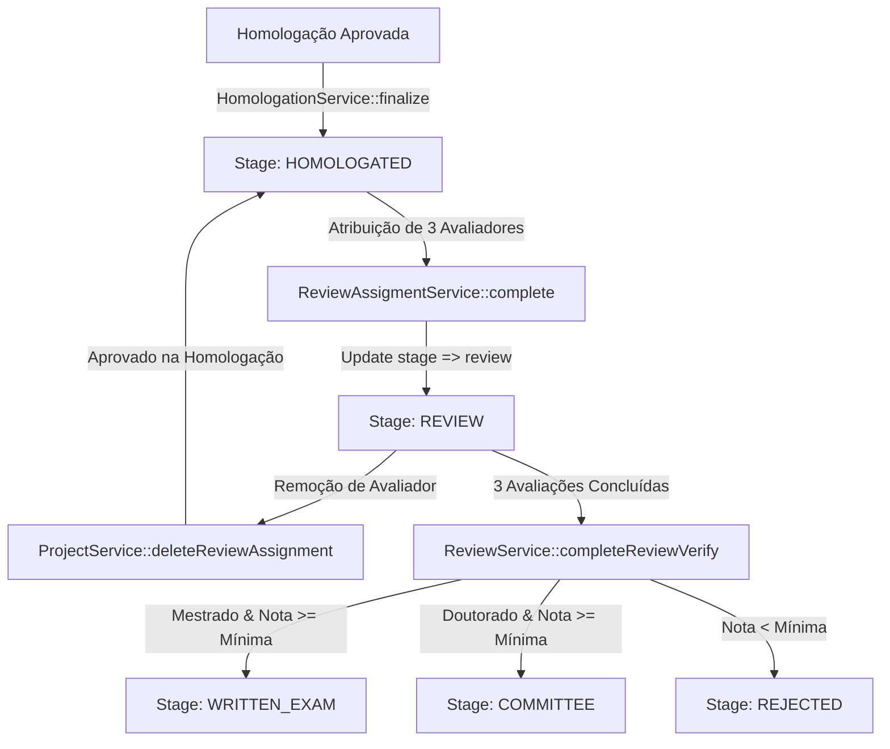

# Requirements

### Overview & Goals
Identificar a causa raiz, mensurar o impacto operacional e sistêmico nas etapas presentes e futuras, e implementar a correção para o incidente em produção onde projetos homologados e distribuídos (especificamente os registros `564` e `530`) permaneceram com o status "Em homologação" (`stage = imported`).

### Scope
- **In Scope:**
  - Diagnóstico aprofundado dos fatores que levaram os registros `564` e `530` a permanecerem em `stage = imported`.
  - Análise de impacto no fluxo de avaliação atual ("Em avaliação"), na transição para a prova escrita ("Em aplicação de prova") e comitê ("Em avaliação do comitê").
  - Correção pontual e em lote do estado dos dados no banco de dados para os projetos afetados.
  - Correção de código em serviços (`ProjectService`, `ReviewAssigmentService`), controllers (`ProjectsController`) e comandos CLI (`ProjectRemoveEvaluatorCommand`) para evitar novas regressões de status.
  - Testes automatizados (Pest) cobrindo as transições e remoções de avaliadores.
- **Out of Scope:**
  - Alterações na interface de avaliação dos docentes (que já opera por atribuição direta via `review_assignments`).
  - Mudanças nas regras de negócio de pontuação mínima de cotas/ampla concorrência.

### User Stories & Stakeholder Impact
- **Como Administrador do Processo Seletivo**, quero que todos os projetos homologados e distribuídos reflitam corretamente seu estágio atual no painel e relatórios para manter a transparência, controle de prazos e consistência operacional.
- **Como Avaliador / Docente**, quero continuar avaliando meus projetos atribuídos sem bloqueios ou inconsistências de dados.
- **Como Candidato**, quero que meu projeto avance pelas etapas de avaliação, prova escrita e comitê de forma íntegra e sem retenção indevida na homologação.

### Functional Requirements & Root Cause Analysis

#### 1. Causa Raiz do Erro
A investigação revelou uma conjunção de dois problemas:
1. **Regressão indevida em `ProjectService::deleteReviewAssignment` e `ProjectRemoveEvaluatorCommand`**: Quando um avaliador é removido ou desvinculado de um projeto (por exemplo, ajuste manual de distribuição pela comissão), o método executa explicitamente:
   ```php
   $this->project->update(['stage' => ProjectStage::IMPORTED]);
   ```
   Isso força o projeto a retroceder para `stage = imported` ("Em homologação"), desconsiderando que o projeto já havia sido aprovado na homologação (`homologation_status = approved`).
2. **Erro de sintaxe na transição de fase em `ReviewAssigmentService::complete()`**: Ao avançar a fase de Distribuição para Avaliação, a atualização em lote dos projetos foi escrita com vírgula em vez de atribuição associativa:
   ```php
   // Código atual em ReviewAssigmentService.php (linha 148):
   $project->update(['stage', ProjectStage::REVIEW]); // Eloquent ignora argumentos indexados numericamente!
   ```
   Como resultado, o Eloquent gerou um `UPDATE` vazio apenas com `updated_at`, sem alterar o `stage` para `review`. Os projetos com 3 avaliadores adicionados manualmente subiram para `review`, mas os que tiveram remoção prévia permaneceram em `imported` (ou `homologated`).

#### 2. Impacto nas Próximas Etapas (Estamos "Em Avaliação" atualmente)
- **Na etapa atual ("Em Avaliação"):**
  - **Avaliadores conseguem avaliar normalmente:** O endpoint dos avaliadores (`EvaluateController@index`) consulta `review_assignments` vinculados ao usuário logado, independentemente do `stage` do projeto. Prova disso é que os registros `564` e `530` já possuem pareceres submetidos e pendentes registrados no banco de produção.
  - **Relatórios e Filtros de Gestão:** Projetos com `stage = imported` aparecem incorretamente nas listagens administrativas e relatórios de homologação em vez de relatórios de avaliação.
  - **Conclusão de Avaliações (`completeReviewVerify`):** Quando o 3º avaliador submeter a nota de um projeto, o método `ProjectService@startWrittenExam` (Mestrado) ou `startCommitteeReview` (Doutorado) atualiza o `stage` diretamente para `written_exam` ou `committee` (se atingir a nota mínima) ou `rejected` (se reprovado). Portanto, ao concluir todas as avaliações, o status seria corrigido automaticamente para a próxima fase.
- **Ao finalizar a fase de Avaliação (`ReviewService::finalize`):**
  - A finalização verifica se existem avaliações com `status != submitted`.
  - Se a fase for encerrada com projetos ainda pendentes ou sem nota, o comando busca projetos com `stage = WRITTEN_EXAM` para criar os registros de prova escrita. Projetos que permanecerem em `imported` não seriam inicializados na prova escrita, gerando descontinuidade no fluxo do candidato.

#### 3. Correção
- Ajustar os dados em produção dos registros `564` e `530` (e quaisquer outros homologados pendentes na fase `REVIEW`) para `stage = ProjectStage::REVIEW`.
- Corrigir o código-fonte para que desatribuições e transições respeitem o estado homologado e atualizem corretamente a coluna `stage`.

# Technical Design

### Current Implementation
- `app/Domain/Projects/Services/ProjectService.php` (linha 38): Reseta indevidamente `$this->project->update(['stage' => ProjectStage::IMPORTED]);` ao remover `ReviewAssignment`.
- `app/Console/Commands/ProjectRemoveEvaluatorCommand.php` (linha 59): Atualiza `stage => ProjectStage::IMPORTED` caso `$remainingCount < 3`.
- `app/Domain/SelectionProcess/Services/ReviewAssigmentService.php` (linha 148): Executa `$project->update(['stage', ProjectStage::REVIEW]);` (sintaxe inválida para o Eloquent).
- `app/Http/Controllers/Projects/ProjectsController.php` (linhas 408 e 419): Contém chamadas com vírgula `['stage', ProjectStage::...]`.

### Key Decisions
1. **Preservar integridade do estágio homologado durante remoção de avaliadores:** Se um projeto já teve sua homologação aprovada (`homologation_status === APPROVED`), remover uma atribuição de avaliador deve reverter o projeto para `ProjectStage::HOMOLOGATED` ("Em distribuição") ou manter alinhado à fase atual caso o processo esteja em `REVIEW`, mas **nunca** para `ProjectStage::IMPORTED`.
2. **Correção de dados não destrutiva:** A correção dos registros `564`, `530` e correlatos atualizará o `stage` para `ProjectStage::REVIEW` sem afetar as notas e pareceres já gravados em `reviews` / `review_assignments`.
3. **Criação de comando CLI de sincronização:** Desenvolver um comando Artisan seguro e idempotente (`projects:sync-stages`) que pode ser executado em produção para alinhar todos os projetos ao estágio coerente com a fase do processo e a quantidade de pareceres.

### Proposed Changes

#### 1. `app/Domain/Projects/Services/ProjectService.php`
Substituir a atribuição fixa de `IMPORTED` por verificação do status de homologação e fase:
```php
public function deleteReviewAssignment(Project|ReviewAssignment|null $item = null): void
{
    if ($item instanceof Project) {
        $this->project = $item;
    }
    if (! $this->project) {
        return;
    }

    if ($item instanceof ReviewAssignment) {
        $item->delete();
    } else {
        $this->project->reviewAssignments()->delete();
    }

    $fallbackStage = $this->project->homologation_status === ProjectHomologationStatus::APPROVED
        ? ProjectStage::HOMOLOGATED
        : ProjectStage::IMPORTED;

    $this->project->update([
        'stage' => $fallbackStage,
    ]);
}
```

#### 2. `app/Domain/SelectionProcess/Services/ReviewAssigmentService.php`
Corrigir o array associativo em `complete()`:
```php
$projects->each(function (Project $project) {
    $project->update([
        'stage' => ProjectStage::REVIEW,
    ]);
});
```

#### 3. `app/Console/Commands/ProjectRemoveEvaluatorCommand.php`
Ajustar o fallback do estágio quando restarem menos de 3 avaliadores:
```php
if ($remainingCount < 3) {
    $fallbackStage = $project->homologation_status === ProjectHomologationStatus::APPROVED
        ? ProjectStage::HOMOLOGATED
        : ProjectStage::IMPORTED;

    $project->update([
        'stage' => $fallbackStage,
    ]);
}
```

#### 4. `app/Http/Controllers/Projects/ProjectsController.php`
Corrigir sintaxe nas linhas 408 e 419:
- Linha 408: `$project->update(['stage' => ProjectStage::IMPORTED]);`
- Linha 419: `$project->update(['stage' => ProjectStage::HOMOLOGATED]);`

#### 5. Comando de Sincronização de Dados (`app/Console/Commands/ProjectSyncStagesCommand.php`)
Comando para corrigir projetos em produção:
- Se processo em `REVIEW` e projeto aprovado na homologação com avaliações em andamento/pendentes: define `stage = review`.
- Se todas as 3 avaliações estiverem submetidas: executa `completeReviewVerify()` para avançar ao estágio correto (`written_exam`, `committee` ou `rejected`).

### Architecture Diagram



### Risks & Mitigations
- **Risco:** Sobrescrever o estágio de projetos que já foram para a Prova Escrita ou Comitê.
  - **Mitigação:** O comando de correção só altera projetos cujo `stage` atual seja `imported` ou `homologated` em processos seletivos cuja fase é `REVIEW`.
- **Risco:** Perda de avaliações já preenchidas pelos docentes nos projetos 564 e 530.
  - **Mitigação:** A atualização afeta exclusivamente o atributo `stage` na tabela `projects`, mantendo intactos os registros de `review_assignments` e `reviews`.

# Testing

### Validation Approach
A validação do plano e da correção será realizada por meio de testes unitários e funcionais no Pest, além da validação com o banco de dados réplica de produção configurado em `.env.test`.

### Key Scenarios
1. **Transição de Fase Distribuição -> Avaliação:**
   - Garantir que ao chamar `ReviewAssigmentService::complete()`, todos os projetos aprovados com 3 avaliadores tenham seu `stage` alterado de `homologated` para `review`.
2. **Remoção de Avaliador de Projeto Homologado:**
   - Garantir que ao excluir um avaliador via `ProjectService::deleteReviewAssignment()` ou `ProjectRemoveEvaluatorCommand`, o projeto retorne para `stage = homologated` e não para `stage = imported`.
3. **Execução do Data Fix nos Registros 564 e 530:**
   - Executar a sincronização no ambiente com banco de teste/produção (`.env.test`).
   - Verificar que os registros `564` e `530` passam de `stage = imported` para `stage = review` mantendo as avaliações existentes (tanto as já submetidas quanto as pendentes).
4. **Fluxo Completo até a Próxima Fase:**
   - Simular a submissão das notas restantes para os projetos 564 e 530 e verificar se avançam perfeitamente para `written_exam` ou `committee` conforme a modalidade (Mestrado/Doutorado).

### Test Changes
- Adicionar asserções em `tests/Feature/SelectionProcess/ReviewAssignmentTest.php` validando `$project->fresh()->stage->value === ProjectStage::REVIEW->value`.
- Adicionar teste em `tests/Feature/Domain/Projects/Services/ProjectServiceTest.php` verificando o estágio resultante após a exclusão de atribuição.
- Adicionar teste para o novo comando de sincronização de estágios (`ProjectSyncStagesCommandTest.php`).

# Delivery Steps

### ✓ Step 1: Corrigir lógica de transição e regressão de estágios no código backend
- Update `app/Domain/Projects/Services/ProjectService.php` in `deleteReviewAssignment()` so removing an evaluator or resetting assignments restores `ProjectStage::HOMOLOGATED` instead of reverting to `ProjectStage::IMPORTED` when the project is already homologated (`homologation_status === APPROVED`).
- Update `app/Console/Commands/ProjectRemoveEvaluatorCommand.php` so dropping below 3 evaluators does not reset `stage` to `IMPORTED` if the project is approved.
- Fix array syntax in `app/Domain/SelectionProcess/Services/ReviewAssigmentService.php` (`complete()`) from `['stage', ProjectStage::REVIEW]` to `['stage' => ProjectStage::REVIEW]`.
- Fix array syntax in `app/Http/Controllers/Projects/ProjectsController.php` (lines 408 and 419) replacing commas with key-value assignments.

### ✓ Step 2: Criar comando de correção e alinhamento de dados (Data Fix)
- Create an Artisan command (e.g. `php artisan projects:sync-stages {selection?}`) or data correction script to inspect all projects in the active selection process.
- For registers 564 and 530 (and all homologated projects in the REVIEW phase with active/pending reviews), update `stage` to `ProjectStage::REVIEW` (`stage = 'review'`).
- For any project where all 3 evaluations are already submitted, trigger `completeReviewVerify()` / `calculeReviewStepScore()` to advance them to `WRITTEN_EXAM`, `COMMITTEE`, or `REJECTED` according to their modality and score.
- Execute dry-run and validation against the test/production replica environment (`.env.test`).

### ✓ Step 3: Implementar testes automatizados e validação de não-regressão
- Add Pest tests in `tests/Feature/SelectionProcess/ReviewAssignmentTest.php` asserting that completing the distribution phase updates all approved projects to `ProjectStage::REVIEW`.
- Add tests in `tests/Feature/Domain/Projects/Services/ProjectServiceTest.php` and `tests/Feature/Console/ProjectRemoveEvaluatorCommandTest.php` ensuring that removing an evaluator does not revert approved projects to `ProjectStage::IMPORTED`.
- Run tests via `php artisan test --compact` to verify everything passes without regression.